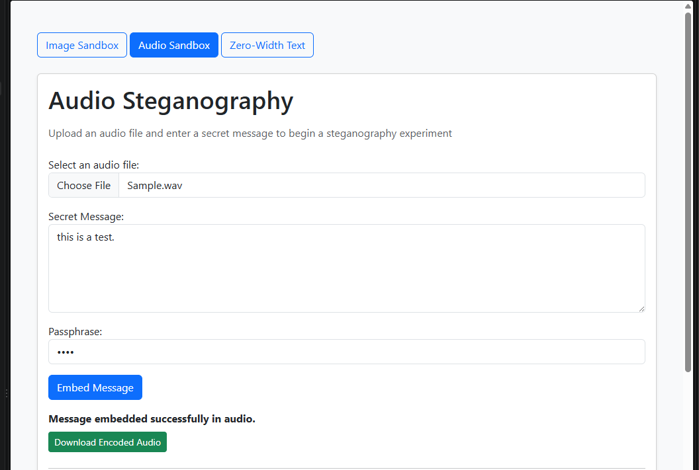
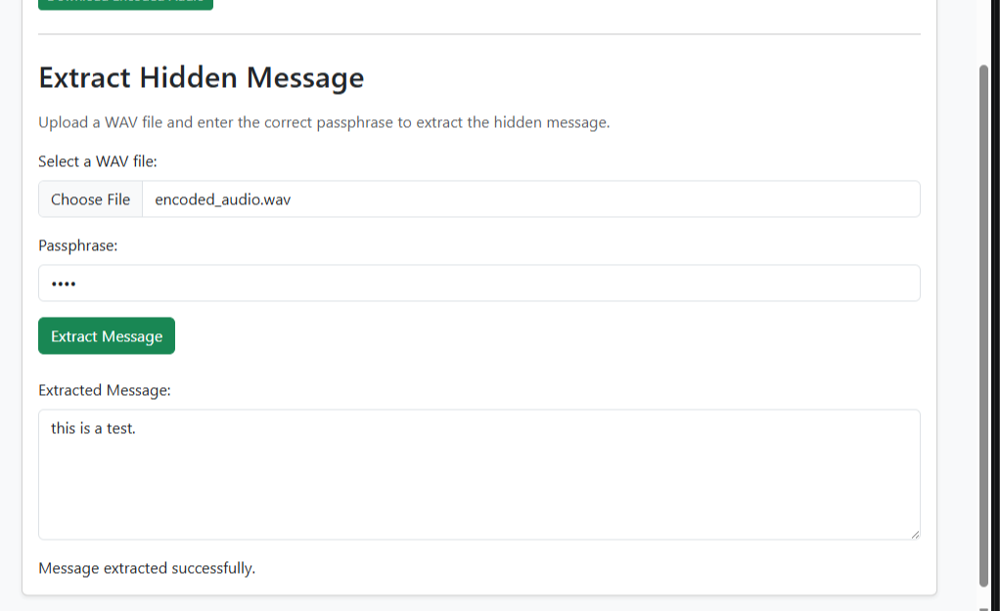

# Team 2 Week 10 Progress Report

## Comprehensive Web-Based Steganography Sandbox 

**Team:** Bryan Goodman, Kendra Pelzer, Jamaal Spratley
#
**Reporting period:** Week 10
## 1. Milestones achieved
- 

## 2. Subtasks completed
| Subtask | Owner | Completed work |
| --- | --- | --- |
| Team Leader | Jamaal Spratley | Implemented audio into the app and ran the first test for encoding and now decoding |
| Member A (Backend) | Bryan Goodman | Ensured the audio steganography communicates with the main branch. Completed Pytest for audio steganography and make sure there are no warnings. |
| Member B (Frontend/QA) | Kendra Pelzer | Developed the audio steganography decryption interface, including status feedback and a read-only message output field. Created and successfully completed three automated Pytest. |

## 3. Test evidence

### 3.1 Bryan

**Purpose:** 

**Expected Result:** 

**Result:**  

**Completed Pytest**

*Image 1: 

*Image 2: 

#
### 3.2 Frontend Audio Decryption - Kendra

**Frontend Tests:**

**Expected result:**

**Result:** 

*Image 3:*

#
### 3.3 Jamaal

**Purpose:** 

**Expected result:** 

**Result:** 

## 4. Lessons learned

- 

## 5. Progress against the plan

The Week 10 the plan required 

The Week 11 will focus on working towards
