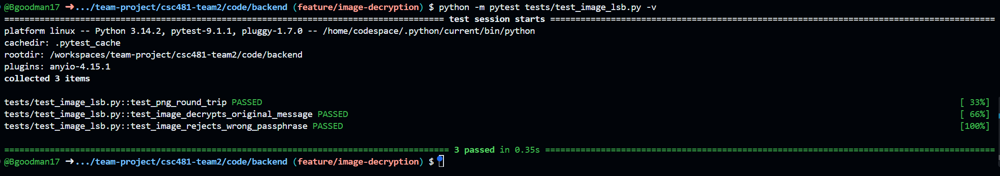
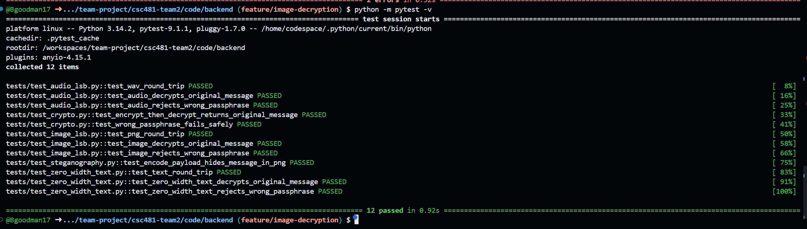
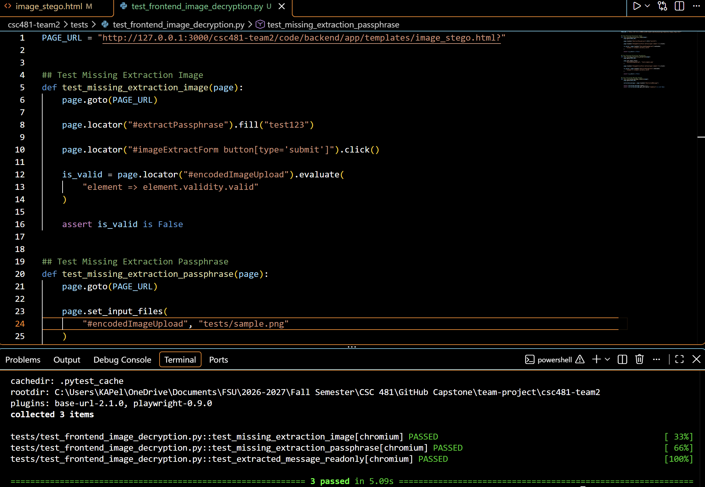
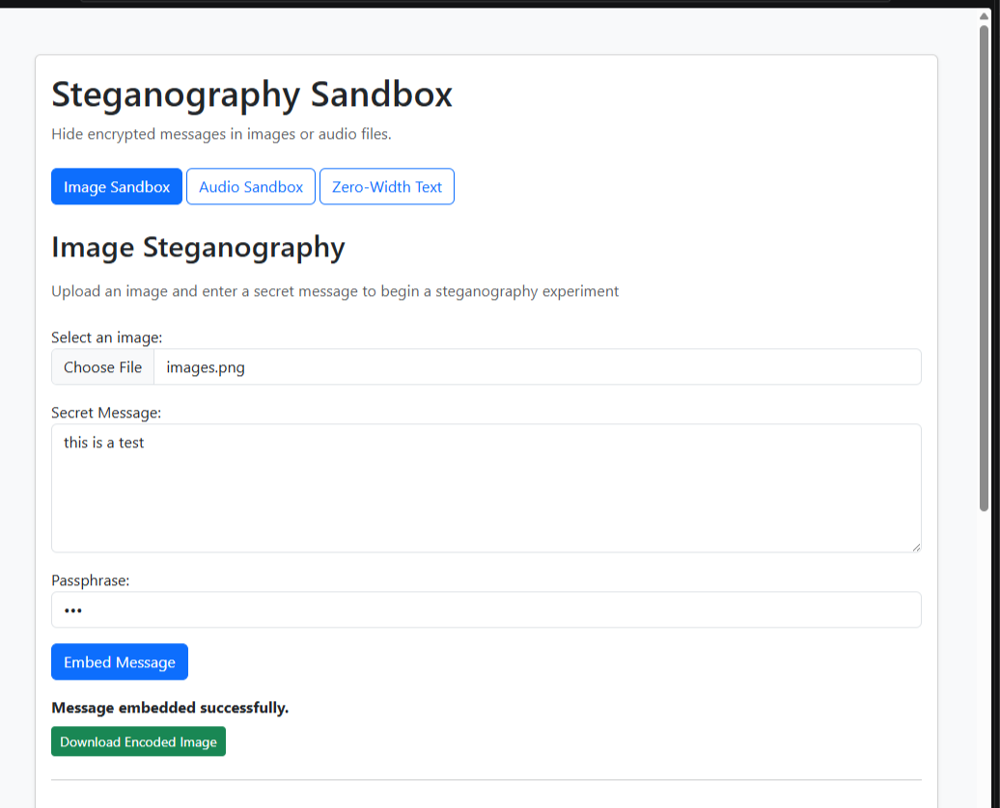
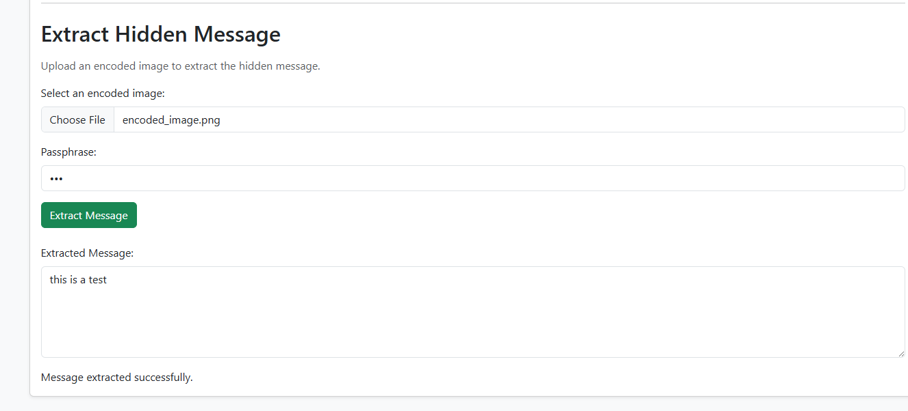

# Team 2 Week 10 Progress Report

## Comprehensive Web-Based Steganography Sandbox 

**Team:** Bryan Goodman, Kendra Pelzer, Jamaal Spratley
#
**Reporting period:** Week 10
## 1. Milestones achieved
- Completion of the image steganography decryption process. The backend can now extract an encrypted message from a PNG image, decrypt it with the correct passphrase, and safely reject an incorrect passphrase.
- Developed the image steganography decryption frontend, including PNG image upload, passphrase input, extraction controls, and read-only output.
- The full implementation of image steganography into the app.py sandbox.

## 2. Subtasks completed
| Subtask | Owner | Completed work |
| --- | --- | --- |
| Team Leader | Jamaal Spratley | Full Implementation of image into the app and ran the first test|
| Member A (Backend) | Bryan Goodman | Ensured the audio steganography communicates with the main branch. Completed Pytest for audio steganography and make sure there are no warnings. |
| Member B (Frontend/QA) | Kendra Pelzer | Developed the image steganography decryption interface with PNG upload, passphrase input, extraction button, status feedback, and read-only message field. Created and successfully completed three automated Pytests to verify input validation and output field configuration. |

## 3. Test evidence

### 3.1 Bryan

**Purpose:** Verify image steganography can extract encrypted message from PNG image and decrypt correctly with proper passphrase. 

**Expected Result:** Pytest completion with no errors or expected warnings. 

**Result:**  Pytest completed with no warnings and 100% passed. 

**Completed Pytest**

*Image 1: Pytest of test_image_lsb.py showing completion*

*Image 2: Full pytest, all test passed 100% with no warnings.*

#
### 3.2 Frontend Audio Decryption - Kendra

**Frontend Tests:**
Verify that the image decryption interface validates required inputs and provides a read-only field for displaying extracted messages.

**Expected result:**
The interface prevents submissions when a PNG image or passphrase is missing and includes a read-only output field for extracted messages.

**Result:** 
PASS. All three automated frontend Pytests passed successfully. The tests confirm required input validation and the read-only message field configuration.

*Image 3: Image steganography decryption frontend with three automated tests passing.*

#
### 3.3 Jamaal

**Purpose:**  Implement and test image encode and decode.  

**Expected result:**  Message was successfully encoded downloaded and later decoded.

**Result:** 

*Image 4: Image steganography encryption and download working

*Image 5: Image steganography decryption working.

## 4. Lessons learned

- I learned that testing both the correct and incorrect passphrase paths are important. Features are not secure unless it is able to have the authorized message recovered safely while rejecting unauthorized access. 
- Gained a better understanding of how HTML element IDs and JavaScript event listeners work together. Also gained experience troubleshooting automated test failures caused by mismatched element IDs and incorrect file paths.
- I learned that errors in the code can alter what the passphrase is saved as in the file when it is encoded making decoding impossible as it’s looking for something for data that the passphrase is not saved as.

## 5. Progress against the plan

The Week 10 the plan required completing and testing image steganography decryption, including correct and incorrect passphrase handling. The frontend decryption interface was completed, and three automated frontend Pytests were successfully executed with no failures. The app.py image encode and decode is fully implemented and first tests are successful. The progress this week is on schedule, and all members are working on their goal.

The Week 11 will focus on working towards  finalizing sandbox as pertains to our rubric 
