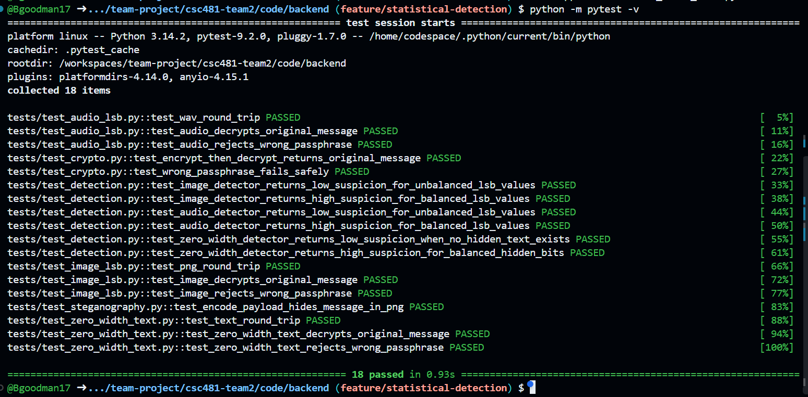
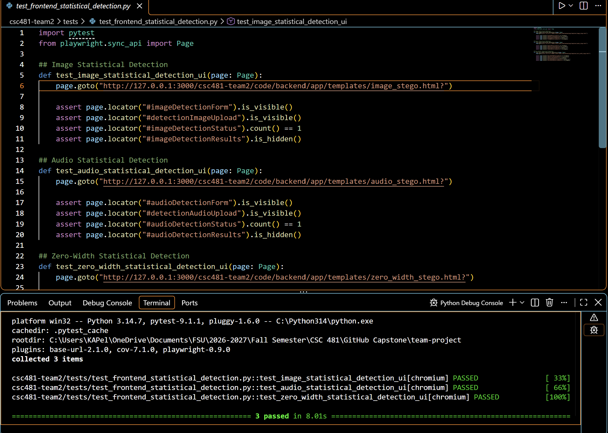
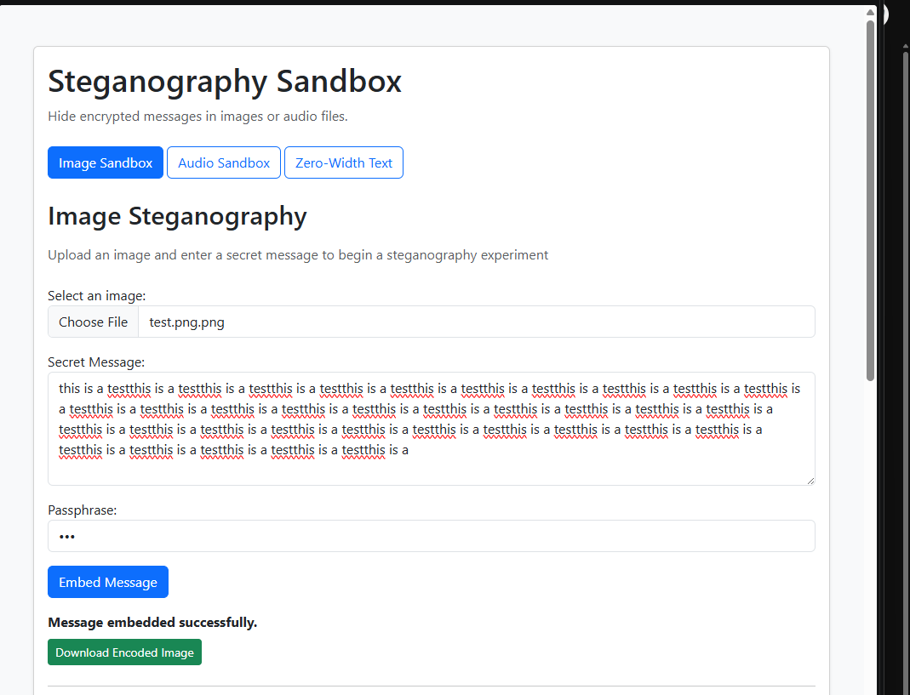
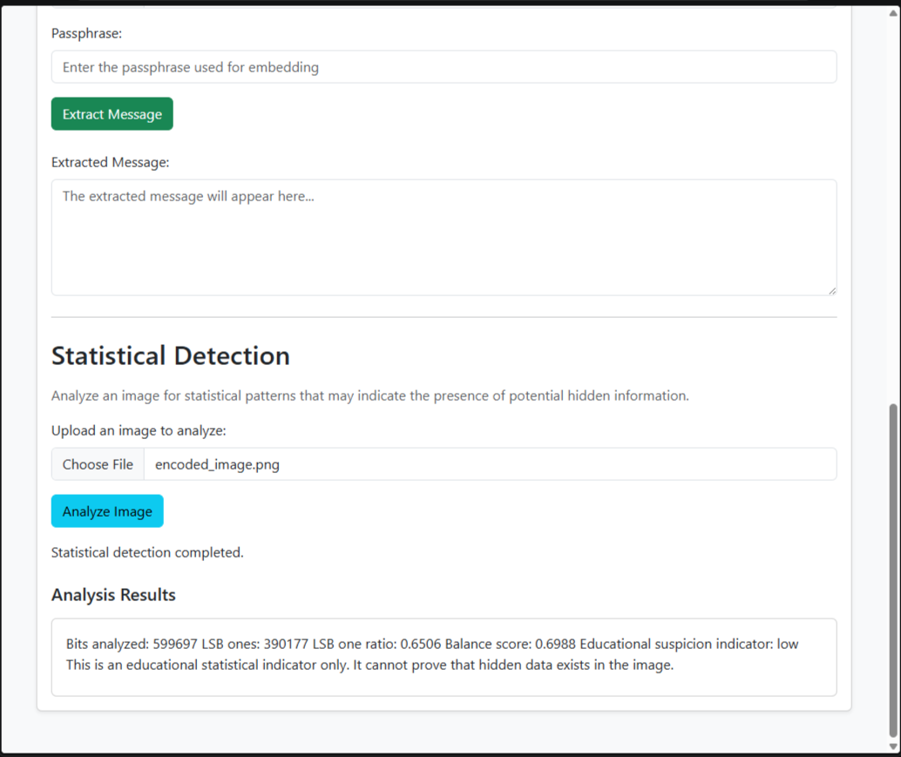

# Team 2 Week 11 Progress Report

## Comprehensive Web-Based Steganography Sandbox 

**Team:** Bryan Goodman, Kendra Pelzer, Jamaal Spratley
#
**Reporting period:** Week 11
## 1. Milestones achieved
- Initiated the statistical detection module to support image, audio, and zero-width text steganography.
- Developed statistical detection frontend interfaces for image, audio, and zero-width text steganography. Modifications include input fields, analysis button, status messages, and result display sections.
- Iplementation of image statistical Detection 

## 2. Subtasks completed
| Subtask | Owner | Completed work |
| --- | --- | --- |
| Team Leader | Jamaal Spratley | Full implementation of image statistical detection for app.py|
| Member A (Backend) | Bryan Goodman | Ensured the audio steganography communicates with the main branch. Completed Pytest for audio steganography and make sure there are no warnings. |
| Member B (Frontend/QA) | Kendra Pelzer | Developed statistical detection frontend sections for image, audio, and zero-width text steganography. Updated the zero-width page layout and created automated frontend tests to verify the new elements. |

## 3. Test evidence

### 3.1 Bryan

**Purpose:** Create and implement statistical detection module to support image, audio, and zero-width text steganography. 

**Expected Result:** Creation of script that has no errors when the pytest is implemented. 

**Result:** Completion of two pytest. One for the testing of the module and the other is full pytest to ensure everything is communicating with no errors. 

**Completed Pytest**

.png)

*Image 1: test_dection.py pytest*

*Image 2: Completion of Full pytest to ensure complete communication with other services. 

#
### 3.2 Frontend Audio Decryption - Kendra

**Frontend Tests:**
Verify that the new statistical detection interfaces for image, audio, and zero-width text steganography display the required elements correctly.

**Expected result:**
All three interfaces should display their respective detection forms and input fields, with the results sections initially hidden until analysis via backend is available.

**Result:**
PASS. All three automated frontend Pytests passed. The tests confirmed that the detection forms, input fields, and status elements were present and the results sections were hidden.

*Image 3: All three statistical detection frontend tests passed successfully*

#
### 3.3 Jamaal

**Purpose:** Create and implement statistical detection module for the app.py.
**Expected result:** the app.py accepting any image and determining if the images have a hidden message already embedded in it.

**Result:**  The statistical detection is working and running.

*Image 4:

*Image 5:

## 4. Lessons learned

- I learned that each carrier stores hidden data differently, so detection has to be adaptable for images, audio files, and zero-width text instead of having one approach for each file type. 
- I learned more about organizing HTML elements to improve the layout and usability of the frontend interfaces. I also gained experience troubleshooting automated Pytests by correcting file paths and local server URLs.
- I learned that statistical detection is not always accurate since smaller messages change the image's pixel data less

## 5. Progress against the plan

The Week 11 the plan required the creation of the statistical detection module for backend services, ensure that complete communication occurred with a completed full pytest, and full implementation of the module with the other services. Front interfaces were developed for image, audio, and zero-width text detection, including the necessary input fields, analysis button, and result display areas.

The Week 12 plan will be to implement the PDF export. 
