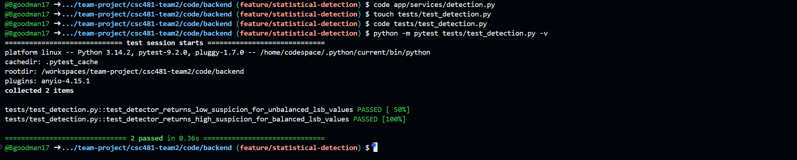
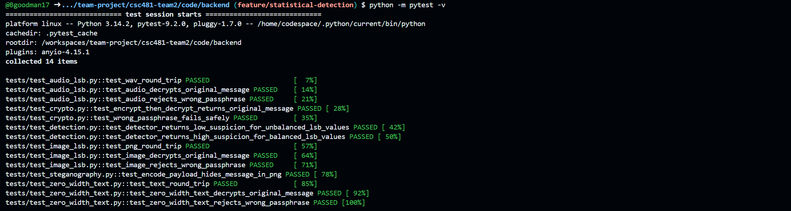

# Team 2 Week 11 Progress Report

## Comprehensive Web-Based Steganography Sandbox 

**Team:** Bryan Goodman, Kendra Pelzer, Jamaal Spratley
#
**Reporting period:** Week 11
## 1. Milestones achieved
- Implemented an image LSB Statistical Detection Module that analyzes the balance of least-significant-bit values in PNG images, returning with low, medium, or high suspicion level.
- 
- 

## 2. Subtasks completed
| Subtask | Owner | Completed work |
| --- | --- | --- |
| Team Leader | Jamaal Spratley | Full implementation of image into the app and ran the first test|
| Member A (Backend) | Bryan Goodman | Ensured the audio steganography communicates with the main branch. Completed Pytest for audio steganography and make sure there are no warnings. |
| Member B (Frontend/QA) | Kendra Pelzer | Developed the image steganography decryption interface with PNG upload, passphrase input, extraction button, status feedback, and read-only message field. Created and successfully completed three automated Pytests to verify input validation and output field configuration. |

## 3. Test evidence

### 3.1 Bryan

**Purpose:** Create and implement statistical detection module for the backend services. 

**Expected Result:** Creation of script that has no errors when the pytest is implemented. 

**Result:** Completion of two pytest. One for the testing of the module and the other is full pytest to ensure everything is communicating. 

**Completed Pytest**

*Image 1: test_dection.py pytest*

*Image 2: Completion of Full pytest to ensure complete communication with other services. 

#
### 3.2 Frontend Audio Decryption - Kendra

**Frontend Tests:**

**Expected result:**

**Result:** 

*Image 3: 

#
### 3.3 Jamaal

**Purpose:**

**Expected result:**

**Result:** 

*Image 4:

*Image 5:

## 4. Lessons learned

- I learned that a statistical detection result is a helpful indicator, but it does not prove that hidden data is within the image. Testing the module with different LSB patterns helps ensure that the detection values act accordingly.
- 
- 

## 5. Progress against the plan

The Week 11 the plan required the creation of the statistical detection module for backend services, ensure that complete communication occurred with a completed full pytest, and full implementation of the module with the other services. 

The Week 12 plan will be to implement the PDF export. 
