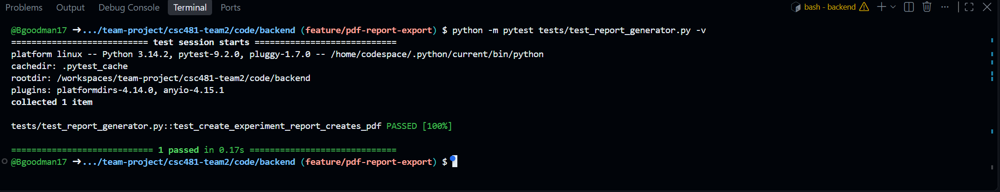
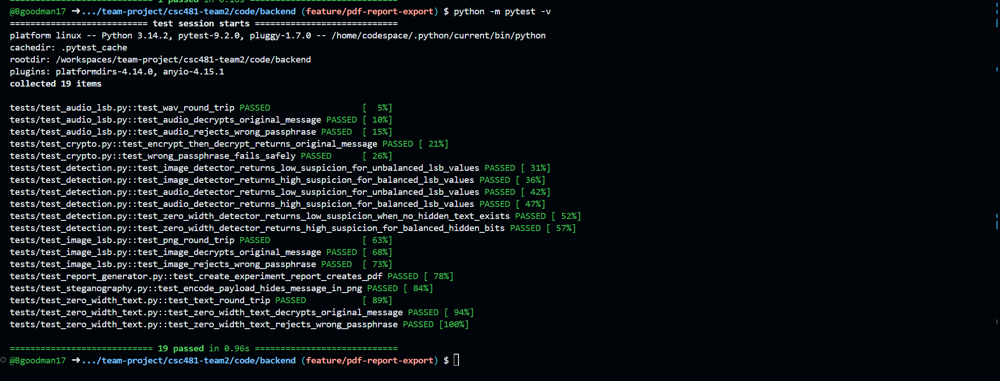
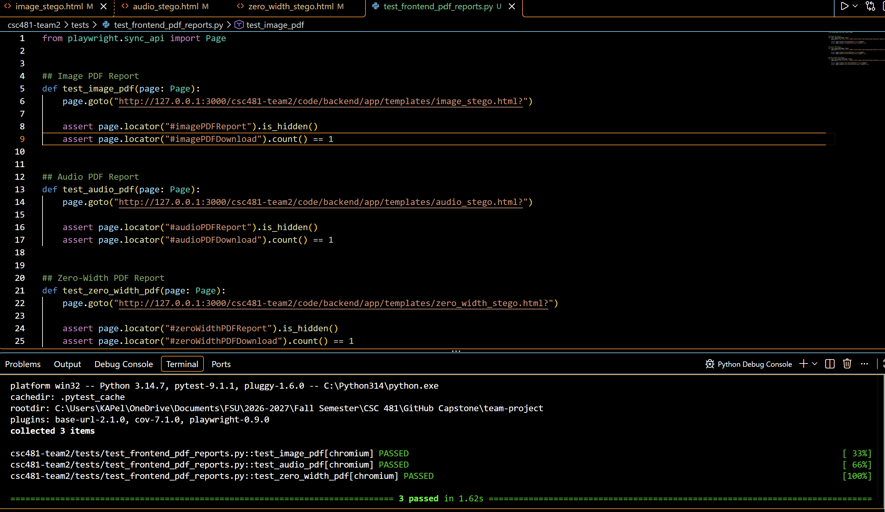
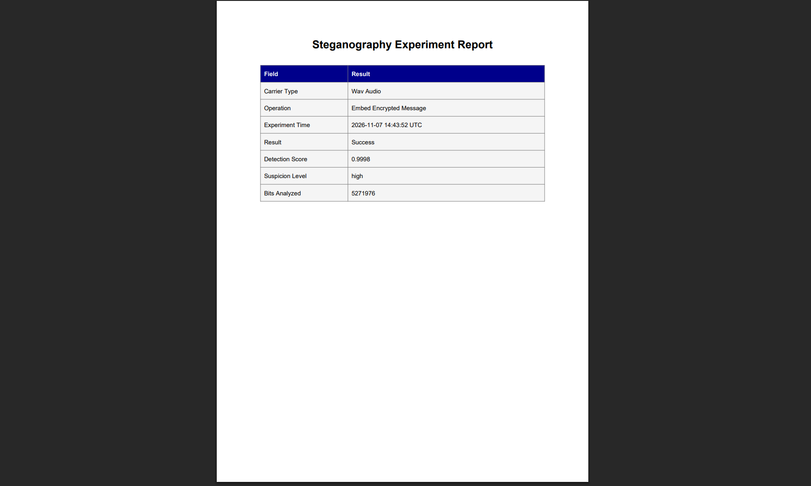
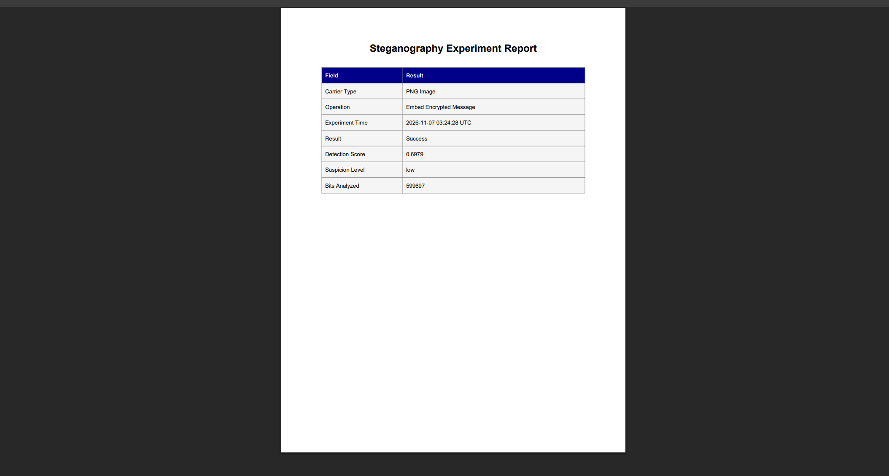
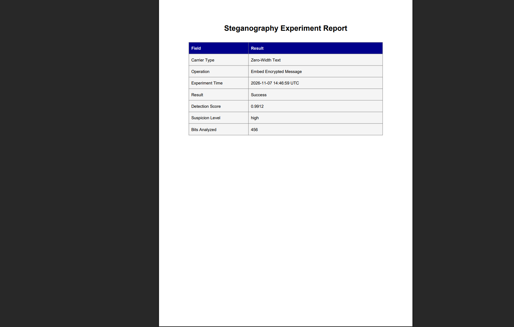

# Team 2 Week 12 Progress Report

## Comprehensive Web-Based Steganography Sandbox 

**Team:** Bryan Goodman, Kendra Pelzer, Jamaal Spratley
#
**Reporting period:** Week 12
## 1. Milestones achieved
- Implemented and tested PDF report export feature that generates experiment summary details and outcome information. 
- Developed PDF report download interfaces for image, audio, and zero-width text steganography. Implemented frontend functionality to display PDF download buttons when a valid report URL is returned by the backend.
- Implemented PDF report export for text, audio, and image in the app.py for future use.

## 2. Subtasks completed
| Subtask | Owner | Completed work |
| --- | --- | --- |
| Team Leader | Jamaal Spratley | Full implementation of PDF report export for app.py |
| Member A (Backend) | Bryan Goodman | Ensured the audio steganography communicates with the main branch. Completed Pytest for audio steganography and made sure there are no warnings. |
| Member B (Frontend/QA) | Kendra Pelzer | Developed PDF download interfaces for image, audio, and zero-width text steganography. Added JavaScript to manage PDF button visibility based on backend responses. Improved the zero-width interface by separating embedding and extraction status messages and resetting outdated results. Created and executed three automated PyTests. |

## 3. Test evidence

### 3.1 Bryan

**Purpose:** Create automatic PDF summary of each steganography experiment

**Expected Result:** Implementation and 100% completion of pytest with no errors or warnings. 

**Result:** Full pytest completion. 100% completed with no errors or warnings. 

**Completed Pytest**

*Image 1: PDF Test Generator Pytest*

*Image 2: PDF Export Full Pytest with all services*

#
### 3.2 Frontend PDF Report Interfaces - Kendra

**Frontend Tests:**
Verify that the image, audio, and zero-width text steganography interfaces contain the required PDF download elements and that the buttons remain hidden until a report is available.

**Expected result:**
All three interfaces should contain the PDF download elements, with the download sections initially hidden until a valid report URL is provided by the backend.

**Result:**
PASS. All three automated frontend Playwright tests passed successfully. Tests confirmed that each interface contained exactly one PDF download link and that the PDF download sections were initially hidden.

*Image 3: All three PDF report frontend visibility tests passed successfully.*

#
### 3.3 Jamaal

**Purpose:** Create and implement PDF export report for the app.py.
**Expected result:** the app.py make a PDF report for every use.

**Result:**  The PDF rep is working and running.

*Image 4: PDF export for audio

*Image 5: PDF export for image

*Image 6: PDF export for zero-width

## 4. Lessons learned

- I learned that automated PDF generation makes documentation of the results easier. It also consistently shares them with other users. 
- I learned how to prepare frontend interfaces for PDF report integration by using JavaScript to manage download links based on backend responses. I also gained a better understanding of managing interface states, including hiding unavailable download options and clearing outdated results when new experiments begin.
- I learned that PDF generation requires report lab to work.

## 5. Progress against the plan

The Week 12 the plan required initial PDF export implementation and testing for steganography services and experiments. Frontend interfaces were updated for image, audio, and zero-width text steganography to support PDF report downloads when a valid report URL is returned by the backend. Additional improvements were made to the zero-width text interface to manage status messages and reset previous results. finally added all them to app.py for use in the sandbox. all progress is acording to plan working and running and all members are working to keep updates on schedule.

The Week 13 plan will be to work towards completing the final checks and finishing the final report.