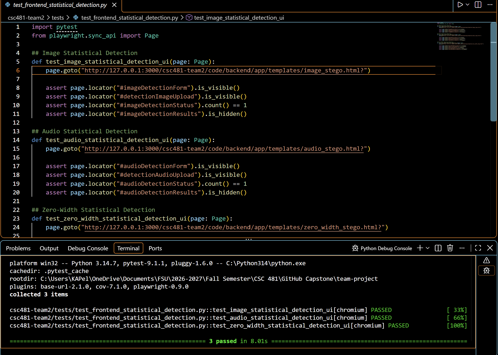

# Team 2 Week 12 Progress Report

## Comprehensive Web-Based Steganography Sandbox 

**Team:** Bryan Goodman, Kendra Pelzer, Jamaal Spratley
#
**Reporting period:** Week 12
## 1. Milestones achieved
- Implemented and tested PDF report export feature that generates experiment summary details and outcome information. 
- 
- Implemented PDF report export for text, audio, and image in the app.py for future use.

## 2. Subtasks completed
| Subtask | Owner | Completed work |
| --- | --- | --- |
| Team Leader | Jamaal Spratley | Full implementation of PDF report export for app.py |
| Member A (Backend) | Bryan Goodman | Ensured the audio steganography communicates with the main branch. Completed Pytest for audio steganography and made sure there are no warnings. |
| Member B (Frontend/QA) | Kendra Pelzer | Developed statistical detection frontend sections for image, audio, and zero-width text steganography. Updated the zero-width page layout and created automated frontend tests to verify the new elements. |

## 3. Test evidence

### 3.1 Bryan

**Purpose:** Create automatic PDF summary of each steganography experiment

**Expected Result:** Implementation and 100% completion of pytest with no errors or warnings. 

**Result:** Full pytest completion. 100% completed with no errors or warnings. 

**Completed Pytest**

*Image 1: PDF Test Generator Pytest*

*Image 2: PDF Export Full Pytest with all services*

#
### 3.2 Frontend Statistical Detection - Kendra

**Frontend Tests:**
Verify that the new statistical detection interfaces for image, audio, and zero-width text steganography display the required elements correctly.

**Expected result:**
All three interfaces should display their respective detection forms and input fields, with the results sections initially hidden until analysis via backend is available.

**Result:**
PASS. All three automated frontend Pytests passed. The tests confirmed that the detection forms, input fields, and status elements were present and the results sections were hidden.

*Image 3: All three statistical detection frontend tests passed successfully*

#
### 3.3 Jamaal

**Purpose:** Create and implement PDF export report for the app.py.
**Expected result:** the app.py make a PDF report for every use.

**Result:**  The PDF rep is working and running.

*Image 4:

*Image 5:

*Image 6:

## 4. Lessons learned

- I learned that automated PDF generation makes documentation of the results easier. It also consistently shares them with other users. 
- 
- I learned that PDF generation requires report lab to work.

## 5. Progress against the plan

The Week 12 the plan required initial PDF export implementation and testing for steganography services and experiments. 

The Week 13 plan will be to  
