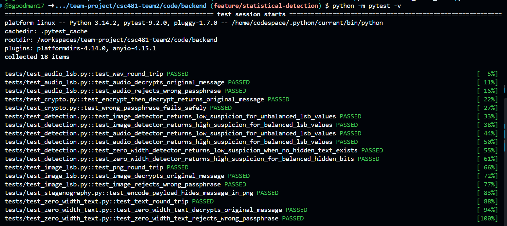
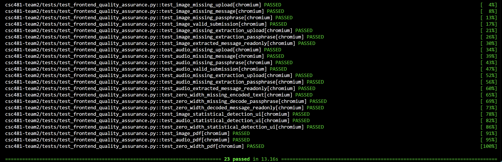
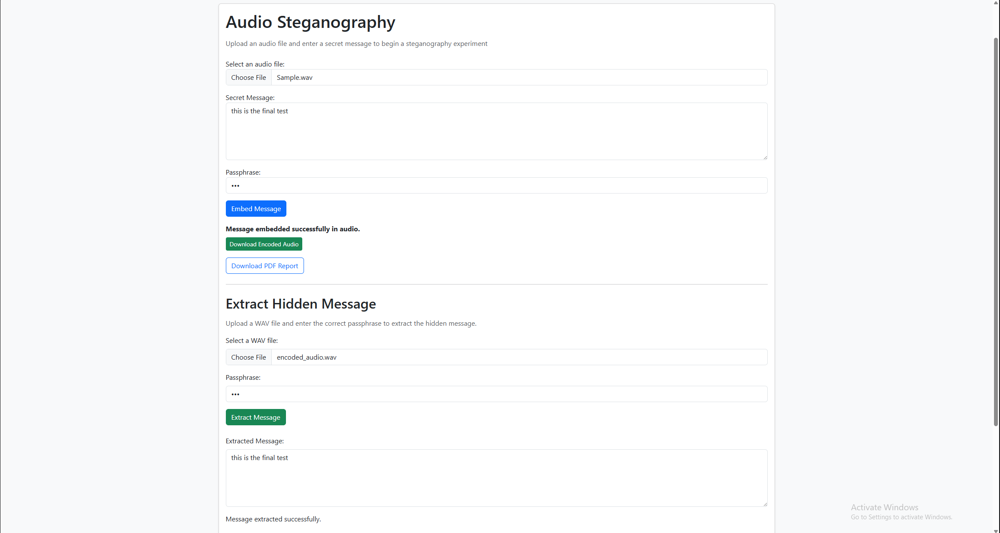
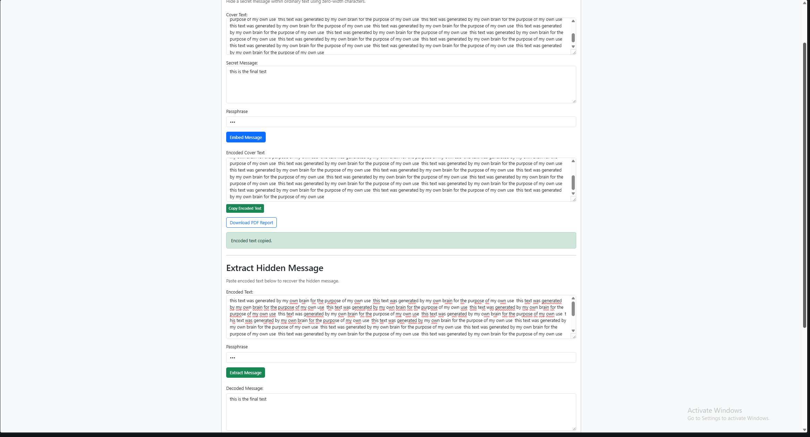
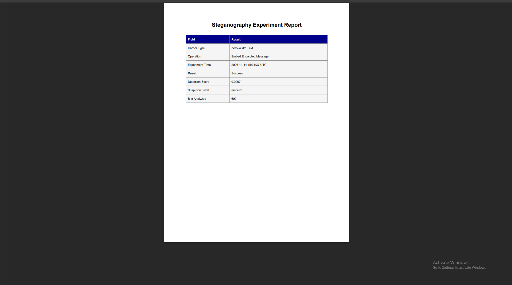

# Team 2 Week 13 Progress Report

## Comprehensive Web-Based Steganography Sandbox 

**Team:** Bryan Goodman, Kendra Pelzer, Jamaal Spratley
#
**Reporting period:** Week 13
## 1. Milestones achieved
- Final pytest completed to make sure everything is still in operating order within the sandbox.
- Improved frontend usability across the image, audio, and zero-width steganography interfaces with clarifying input labels. Consolidated existing frontend tests into a single quality assurance test suite.
- The final tests for sandbox were completed.

## 2. Subtasks completed
| Subtask | Owner | Completed work |
| --- | --- | --- |
| Team Leader | Jamaal Spratley | final tests for the app.py |
| Member A (Backend) | Bryan Goodman | Ensured the audio steganography communicates with the main branch. Completed Pytest for audio steganography and made sure there are no warnings. |
| Member B (Frontend/QA) | Kendra Pelzer | Updated input labels across the image, audio, and zero-width steganography interfaces to improve usability. Consolidated seven existing frontend test files into one quality assurance suite. Executed the Pytests with all 23 tests passing. |

## 3. Test evidence

### 3.1 Bryan

**Purpose:** 
Do a pytest to make sure everything still works correctly in the Sandbox.

**Expected Result:** 
Full pytest completion with no warnings or error messages.

**Result:** 
Completed pytest with no warnings and 100% complete. 

**Completed Pytest**

*Image 1: Full pytest completion with everything in the sandbox. No warnings messages or errors. 100% completed.*

#
### 3.2 Frontend Usability Updates & Testing - Kendra

**Frontend Tests:**
Executed the consolidated frontend quality assurance suite using Pytest.

**Expected result:**
Verified form validation, read-only output fields, statistical detection interfaces, and PDF report elements across the image, audio, and zero-width steganography interfaces.

**Result:**
PASS. All 23 automated tests passed successfully with no failures.

*Image 2: Frontend Quality Assurance Test Results*

#
### 3.3 Jamaal

**Purpose:** 
Execute final test on the sandbox to ensure full functionality.
**Expected result:** 
All is working and running.
**Result:** 
All tests passed.

*Image 3:

*Image 4:

*Image 5:

*Image 6:

## 4. Lessons learned

- I learned that the backend is very important when it comes to the foundation of ensuring everything works. With the pytest completed it shows that the sandbox is fully operational and that everything communications properly. 
- Learned the importance of organizing automated tests into a consolidated quality assurance suite to improve maintainability. Reinforced troubleshooting skills by resolving file naming and local server connection issues encountered during test execution.
- Learned the importance of organization in html files along with the importances of correct import file names when working with PY files.

## 5. Progress against the plan

The Week 13 plan required updating input labels across all three steganography interfaces and consolidation of existing frontend tests into a single automated QA suite. A complete pytest was completed to ensure everything works within the sandbox. Lastly the app.py was put through the final rounds of testings. All progress was on schedule, and all members are working to keep up the progress.

The Week 14 plan will be to work towards completing the final code and presentation slides. 
