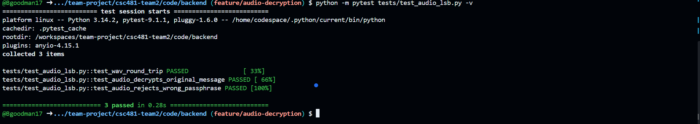
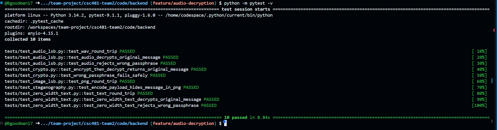
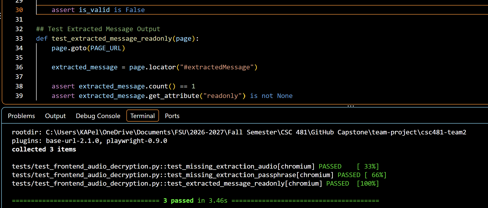
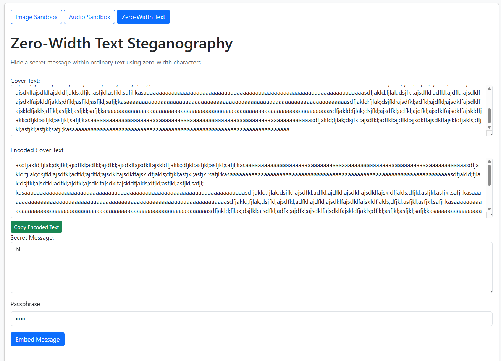
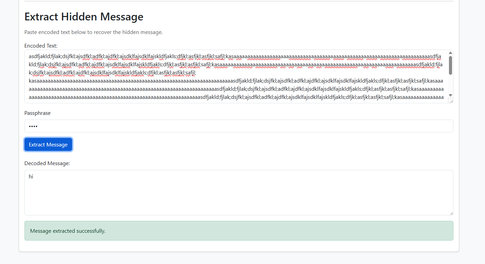

# Team 2 Week 9 Progress Report

## Comprehensive Web-Based Steganography Sandbox 

**Team:** Bryan Goodman, Kendra Pelzer, Jamaal Spratley
#
**Reporting period:** Week 9
## 1. Milestones achieved
- Completion of script editing for audio to ensure communication with the frontend for decryption. 100% passed with no errors achieved.
- Developed the audio steganography decryption frontend, including WAV file selection, passphrase input, extraction controls, and a read-only field for displaying decrypted messages.

## 2. Subtasks completed
| Subtask | Owner | Completed work |
| --- | --- | --- |
| Team Leader | Jamaal Spratley | Implemented zero-width text into the app and ran the first test for encoding and now decoding |
| Member A (Backend) | Bryan Goodman | Ensured the zero-width steganography communicates with the main branch. Completed Pytest for zero-width steganography and make sure there are no warnings. |
| Member B (Frontend/QA) | Kendra Pelzer | Developed the audio steganography decryption interface, including status feedback and a read-only message output field. Created and successfully completed three automated Pytest. |

## 3. Test evidence

### 3.1 Bryan

**Purpose:** To ensure the backend decryption communicates with the frontend. 

**Expected Result:** Completion of both pytests for test_audio_lsb.py and audio_lsb.py. If there are any errors, they are to be corrected to ensure communication. 

**Result:** Both pytest passed with 100% completion and no errors to report. 

**Completed Pytest**

*Image 1: Completion of test_aduio.lsb.py with no errors or warnings. 100% passed. 

*Image 2: Completion of audio_lsb.py with no errors or warnings. 100% passed. 

#
### 3.2 Frontend Audio Decryption - Kendra

**Frontend Tests:**
Verify that the audio decryption frontend correctly handles required input validation and provides a read-only field for displaying decrypted messages.

**Expected result:**
The interface prevents submissions with missing required inputs and provides a read-only output field for future decryption results.

**Result:** 
PASS. All three automated frontend Pytests passed. The tests confirmed the required field validation and output field configuration.

*Image 3: Audio steganography decryption frontend with three automated tests passing.

#
### 3.3 Jamaal

**Purpose:** Add a decryption path to app.py so the zero-width text can be extracted.

**Expected result:** The  secret message should be imported and extracted 

**Result:** The  secret message was extracted correctly 

## 4. Lessons learned

- Learning the importance of import paths became the biggest lesson learned. Without the proper pathing python cannot locate the correct service module which is very important for this process.
- Gained a better understanding of the separation between frontend and backend integration, particularly when preparing an interface for funcionality that will be connected later. Also gained experience troubleshooting file paths and identifying errors during testing.

## 5. Progress against the plan

The Week 9 the plan required pytest for the test_audio_lsb.py and audio_lsb.py scripts. Both pytest passed 100% with no errors to report, ensuring communication with the frontend. The audio steganography decryption interface was completed and all three Pytests were successfully executed. The frontend portion was completed and ready for backend integration.

The Week 10 will focus on working towards the decryption of Image.
